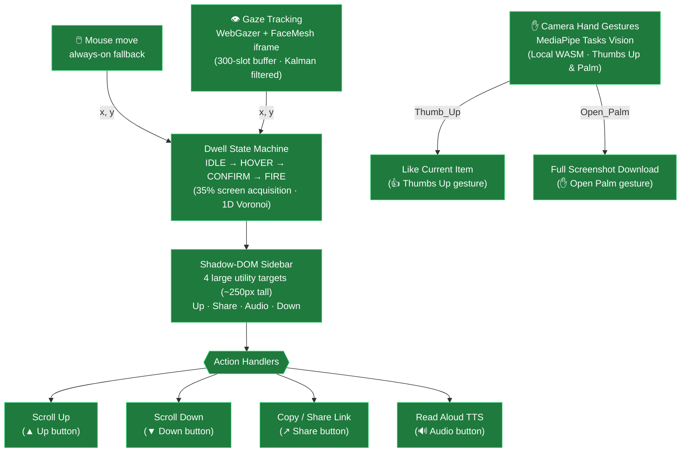

# Project Drishti 2.0

**Gaze + Voice + Gesture Multimodal Browser Companion** — an accessible, hands-free browser extension designed for motor-impaired users (ALS, quadriplegia, cerebral palsy, or temporary injury). See [`Drishti_2.0_Plan.md`](./Drishti_2.0_Plan.md) for the original specification.

Vanilla JavaScript, Manifest V3, zero external runtime CDNs, zero build step. Fully self-contained with offline MediaPipe FaceMesh and MediaPipe Tasks Vision models.

---

## Architecture & System Flow

The diagram below maps the runtime multimodal flow and currently implemented components:



---

## Features Implemented

### 1. Streamlined 4-Button Sidebar ([`sidebar.js`](file:///I:/Drishti%202.0/src/content/sidebar.js))
- Pinned to the right viewport edge inside an isolated Shadow DOM.
- Reduced from 8 small buttons to **4 essential, ultra-large targets** (~250px tall each, occupying 25% of the screen height):
  - **`Up` (▲):** Smooth page scroll up (-80% viewport).
  - **`Share` (↗):** Copies current link to clipboard with fallback to native share sheet.
  - **`Audio` (🔊):** DOM-independent text-to-speech read-aloud via Web Speech API (`SpeechSynthesis`). Click again to stop.
  - **`Down` (▼):** Smooth page scroll down (+80% viewport).
- **Wide Fitts' Law Hitboxes:** The horizontal capture zone covers the entire **right 35% of the screen** (`window.innerWidth * 0.65` to right edge). The left 65% remains a safe reading area.
- **Gap-Free 1D Voronoi Partitioning:** All vertical points in the right 35% seamlessly map to the closest button center with zero dead zones.

### 2. Camera Hand Gestures ([`frame.js`](file:///I:/Drishti%202.0/src/gaze/frame.js), [`content.js`](file:///I:/Drishti%202.0/src/content/content.js))
Powered by an offline, locally bundled MediaPipe Tasks Vision `GestureRecognizer` running in the background worker frame:
- **👍 Thumbs Up (`Thumb_Up`):**
  - Likes the current item.
  - On YouTube: automatically detects and clicks the YouTube Like button.
  - On other websites: surfaces an affirmative action toast.
- **✋ Open Palm (`Open_Palm`):**
  - Captures a high-resolution screenshot of the visible tab via `chrome.tabs.captureVisibleTab`.
  - Automatically saves a timestamped PNG (`drishti-screenshot-<timestamp>.png`) to the user's Downloads folder.
- **False-Trigger Guards:**
  - **Wrist elevation check:** Requires landmark `wrist.y <= 0.82` so resting hands on desks or typing on keyboards does not trigger gestures.
  - **Confidence threshold:** Requires gesture score $\ge 0.50$.
  - **Cooldown:** 2.5-second refractory period prevents duplicate rapid activations.

### 3. Precision Hands-Free 9-Dot Calibration ([`gaze.js`](file:///I:/Drishti%202.0/src/content/gaze.js))
- **100% Automated:** Automatically steps sequentially through all 9 points without requiring keyboard or mouse clicks (Spacebar/click remain optional skip shortcuts).
- **Saccadic Latency Protection:** 650ms settle delay per dot ensures the eye has completely landed and fixated before recording data.
- **Full-Rank 135-Sample Dataset:** Records 15 samples per dot across 9 dots ($15 \times 9 = 135$ samples), exceeding the 120 feature dimensions to ensure a well-conditioned regression matrix.
- **300-Slot Data Window:** WebGazer's regression buffer was expanded from 50 to 300 slots (`src/vendor/webgazer.js`), preserving all 9 dots equally and eliminating buffer overwrite corruption.
- **Calibration Lifecycle Coordination:** Hand gesture recognition is strictly paused during calibration to dedicate 100% CPU and camera bandwidth to eye tracking.

### 4. Controlled Pointer Dynamics & Anti-Jitter ([`content.js`](file:///I:/Drishti%202.0/src/content/content.js))
- **Slew-Rate Speed Cap ($36\text{px}/\text{frame}$):** Prevents the pointer from darting or teleporting across the screen, producing a steady, readable glide (~0.35–0.45s).
- **Fixation Deadband ($<14\text{px}$):** Freezes the cursor when fixating on a point, eliminating micro-tremor vibrations.
- **Progressive Damping Curve:**
  - Fixations ($<45\text{px}$): $\alpha = 0.08$ anchors the pointer inside buttons.
  - Medium shifts ($45\text{px}-150\text{px}$): $\alpha = 0.14$.
  - Saccades ($>150\text{px}$): $\alpha = 0.22$.
- **45% Magnetic Snap:** Visual cursor settles comfortably near the center of the hovered button while the dwell ring fills.

---

## Load & Test the Extension

Drishti 2.0 runs identically on Chrome, Edge, and Brave.

### Installation
1. Open your browser's extensions page:
   - Chrome / Brave: `chrome://extensions` or `brave://extensions`
   - Edge: `edge://extensions`
2. Enable **Developer mode** (top-right or left sidebar).
3. Click **Load unpacked** and select this directory (the root folder containing `manifest.json`).
4. **Project Drishti 2.0** will appear in your extensions list.

### Usage
1. Navigate to any standard website (e.g. [Wikipedia](https://www.wikipedia.org) or [YouTube](https://www.youtube.com)).
2. Click **"Gaze off"** at the top of the sidebar.
3. Allow camera access when prompted.
4. Keep your head steady and look directly at each pulsing red dot as it settles and fills green (~14 seconds total).
5. **Gaze Control:** Glance at the right third of your screen to highlight and dwell on `Up`, `Share`, `Audio`, or `Down`.
6. **Hand Gestures:**
   - Raise your hand and give a **Thumbs Up 👍** to like the video or item.
   - Show an **Open Palm ✋** to capture and download a screenshot.

---

## Project Structure

```
manifest.json                     MV3 extension manifest & permissions
src/
├── background/
│   └── service-worker.js         Message router, settings store, screenshot capture API
├── content/
│   ├── content.js                Content script bootstrap, gesture handlers, pointer dynamics
│   ├── dwell.js                  Dwell state machine (IDLE → HOVER → CONFIRM → FIRE)
│   ├── gaze.js                   Content-side gaze controller & automated 9-dot calibration UI
│   └── sidebar.js                Shadow-DOM sidebar UI, wide hitboxes, gaze cursor
├── gaze/
│   ├── frame.html                Full-viewport sandbox overlay for WebGazer + Tasks Vision
│   └── frame.js                  WASM model execution, camera feed capture, gesture detection
└── vendor/
    ├── mediapipe/
    │   ├── face_mesh/            Bundled FaceMesh solution assets & WASM
    │   └── gesture_recognizer/   Bundled MediaPipe Tasks Vision bundle, WASM & .task model
    └── webgazer.js               Bundled WebGazer library (patched with 300-slot data window)
```

---

## License

GPLv3 / LGPLv3 (aligned with WebGazer.js and MediaPipe open-source licenses).
