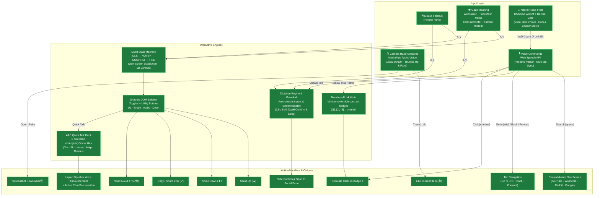

# Project Drishti 2.0

**Gaze + Voice + Gesture Multimodal Browser Companion** — an accessible, hands-free browser extension designed for motor-impaired users (ALS, quadriplegia, cerebral palsy, or temporary motor injury). See [`Drishti_2.0_Plan.md`](./Drishti_2.0_Plan.md) for the original specification.

Vanilla JavaScript, Manifest V3, zero external runtime CDNs, zero build step. Fully self-contained with offline MediaPipe FaceMesh, MediaPipe Tasks Vision models, and browser-native Web Speech APIs.

---

## Architecture & System Flow

The diagram below maps the runtime multimodal flow and currently implemented components:



---

## Features Implemented

### 1. Multimodal Voice Navigation & Context-Aware Search ([`voice.js`](file:///I:/Drishti%202.0/src/content/voice.js))
- **Hands-Free Navigation:** Speak natural commands such as:
  - *"Go to YouTube"*, *"Open Wikipedia"*, *"Go to Reddit"* (automatically adds TLDs and directs tabs).
  - *"Go back"*, *"Go forward"*, *"Scroll down"*, *"Scroll up"*, *"Scroll to top"*, *"Scroll to bottom"*.
- **Intelligent Context-Aware Site Search:**
  - When browsing sites like YouTube, Wikipedia, Amazon, or Reddit, saying *"Search interstellar"* dynamically queries that specific website's native search bar (e.g. typing directly into `input#search` on YouTube).
  - On general web pages, automatically routes queries to Google Search.
- **Accent & Phonetic Tolerance:**
  - Robust regex pattern matching with phonetic aliasing to reliably recognize speech variations and non-native accents (e.g., handles Edge transcribing *"show links"* as *"show lyncx"*, *"hints"*, *"numbers"*, or spoken digits *"one"* through *"fifty"*).
- **Multi-Tab State Persistence & Silence Auto-Recovery:**
  - Synchronizes user activation state via `chrome.storage.local` across all open tabs.
  - Automatically recovers from routine Chromium speech recognition WebSocket disconnections (`network` error) without turning off the toggle or prompting for permissions.

### 2. Two-Stage Audio Noise Suppression & RNNoise Neural VAD ([`frame.js`](file:///I:/Drishti%202.0/src/gaze/frame.js), [`voice.js`](file:///I:/Drishti%202.0/src/content/voice.js))
- **Stage 1: Adaptive Decibel / Energy Gate (RMS):**
  - Instantaneous root-mean-square audio energy analysis in Web Audio API at 48kHz.
  - Automatically suppresses constant background fan hum, air conditioning, and room noise below $-44\text{ dB}$.
  - $350\text{ms}$ hangover hold prevents phrase truncation between syllables and natural vocal pauses.
- **Stage 2: Offline Bundled Mozilla RNNoise Neural Network (WASM):**
  - Zero external network dependencies, zero cloud latency (bundled in `src/vendor/rnnoise/`).
  - Processes 480-sample blocks ($10\text{ms}$ audio frames scaled to 16-bit PCM) through a recurrent neural network to compute Voice Activity Detection ($P_{\text{VAD}} \in [0.0, 1.0]$).
  - Rejects false speech triggers caused by keyboard clicking, desk taps, TV background audio, coughing, or throat clearing ($P_{\text{VAD}} < 0.65$).
- **Dual Visual Voice Feedback:**
  - When Voice is active but silent: the sidebar toggle displays a calm blue dot.
  - When the user actively speaks: the button dot immediately illuminates **vibrant emerald green** (`#2ecc71`) with an energetic pulse, confirming verified human speech in real-time.

### 2. Vimium-Style Numbered Link Hints ([`hints.js`](file:///I:/Drishti%202.0/src/content/hints.js))
- **Hands-Free Deep-Page Navigation:**
  - Triggered by saying *"Show links"*, *"Show hints"*, or pressing `Alt + L`.
  - Scans the visible viewport and overlays high-contrast yellow numbered badges (`[1]`, `[2]`, `[3]`, ...) over all visible links, buttons, and form inputs.
- **Direct Speech or Shortcut Selection:**
  - Speak *"Click 4"* or simply *"4"* to simulate an authentic user click and automatically dismiss all active badges.
  - Auto-hides after 12 seconds of inactivity or upon page scroll.

### 3. Vimium-Style Numbered Link Hints ([`hints.js`](file:///I:/Drishti%202.0/src/content/hints.js))
- **Hands-Free Deep-Page Navigation:**
  - Triggered by saying *"Show links"*, *"Show hints"*, or pressing `Alt + L`.
  - Scans the visible viewport and overlays high-contrast yellow numbered badges (`[1]`, `[2]`, `[3]`, ...) over all visible links, buttons, and form inputs.
- **Direct Speech or Shortcut Selection:**
  - Speak *"Click 4"* or simply *"4"* to simulate an authentic user click and automatically dismiss all active badges.
  - Auto-hides after 12 seconds of inactivity or upon page scroll.

### 4. AAC Quick-Reply Speech Dock ([`aac.js`](file:///I:/Drishti%202.0/src/content/aac.js), [`sidebar.js`](file:///I:/Drishti%202.0/src/content/sidebar.js))
- **Immediate Communication for Non-Verbal Users:**
  - Dwell on the sidebar **`Quick Talk`** tile or press `Alt + A` to toggle an Augmentative and Alternative Communication (AAC) speech drawer.
  - Provides 6 ultra-large, high-contrast dwellable phrase buttons:
    - **`Yes` (✅)**
    - **`No` (❌)**
    - **`Water` (💧)**
    - **`Help!` (🚨)**
    - **`Thanks` (🙏)**
    - **`Back` (↩️)**
- **Dual Output Action:**
  1. Immediately announces the phrase aloud at 100% volume through device speakers using browser-native `SpeechSynthesis`.
  2. Automatically inserts the phrase into any active chat input or message composer (e.g., Discord, WhatsApp Web, Slack, Messenger).

### 5. Social Media Voice Dictation & Gaze Guardrail ([`dictation.js`](file:///I:/Drishti%202.0/src/content/dictation.js))
- **Smart Input Detection:**
  - Automatically binds to focused `input[type="text"]`, `textarea`, or modern `[contenteditable]` rich text editors (Twitter/X, Facebook, YouTube comment threads).
  - Compatible with React and Vue virtual DOMs using prototype value descriptor dispatchers.
- **Accidental Send Prevention (Gaze Guardrail):**
  - Displays a floating docked preview bar showing the transcribed message.
  - Features a **1.5-second SVG Circular Dwell Ring** on `[Confirm & Send]`.
  - Fixating gaze or hovering on the button fills the green dwell progress ring before submitting the form or pressing `Enter`, protecting motor-impaired users from premature accidental sends.

### 6. Streamlined 4-Button Sidebar ([`sidebar.js`](file:///I:/Drishti%202.0/src/content/sidebar.js))
- Isolated in a shadow root on the right viewport edge.
- Header row with independent **Gaze** and **Voice** toggles.
- 4 primary utility targets (~200px tall each, occupying 25% of screen height):
  - **`Up` (▲):** Smooth page scroll up (-80% viewport).
  - **`Share` (↗):** Copies current link to clipboard with native share sheet fallback.
  - **`Audio` (🔊):** DOM-independent text-to-speech read-aloud via Web Speech API. Click again to stop.
  - **`Down` (▼):** Smooth page scroll down (+80% viewport).
- **Wide Fitts' Law Hitboxes:** 35% horizontal screen acquisition zone (`0.65 * innerWidth` to right edge) with zero-gap 1D Voronoi partitioning.

### 7. Camera Hand Gestures ([`frame.js`](file:///I:/Drishti%202.0/src/gaze/frame.js), [`content.js`](file:///I:/Drishti%202.0/src/content/content.js))
- Bundled MediaPipe Tasks Vision `GestureRecognizer` running locally in sandbox iframe:
  - **👍 Thumbs Up (`Thumb_Up`):** Likes the current YouTube video or posts an affirmative toast.
  - **✋ Open Palm (`Open_Palm`):** Captures a high-resolution screenshot via `chrome.tabs.captureVisibleTab` and saves it to the Downloads folder.
  - **Anti-False Trigger:** Enforces wrist elevation threshold ($y \le 0.82$), confidence $\ge 0.50$, and a 2.5-second cooldown.

### 8. Interactive Gaze-Dwell Calibration ([`gaze.js`](file:///I:/Drishti%202.0/src/content/gaze.js))
- **Center-First Orthogonal Pattern:** Starts at screen center $(50\%, 50\%)$ to lock a zero-bias neutral gaze baseline, then calibrates orthogonal axes (top, bottom, left, right) and corners.
- **Interactive Gaze Dwell Lock:** The live gaze cursor appears directly on the calibration screen. Dots advance only when the eye cursor lands and dwells inside the target.
- **720p HD Camera Constraint:** Requests $1280 \times 720$ camera feed for $4\times$ pupil pixel density, dramatically improving iris center detection and eliminating gaze offsets.
- **Magnetic Snapping & Saccade Protection:** 300ms saccadic travel delay plus 40% magnetic pull settles the cursor cleanly onto target centers.

### 9. Opentrack-Inspired Accela Velocity Damping Filter ([`content.js`](file:///I:/Drishti%202.0/src/content/content.js))
- **Continuous Non-Linear Power Gain:** Replaces stepped damping with a continuous velocity-coupled response curve:
  $$\alpha = \alpha_{\min} + (\alpha_{\max} - \alpha_{\min}) \cdot \left(\frac{\text{dist} - D_{\text{deadband}}}{D_{\text{saccade}} - D_{\text{deadband}}}\right)^{1.5}$$
  - **Stationary / Button Dwell ($\le 3.5\text{px}$):** Deadband freezes sensor noise and micro-tremors completely, preventing jitter and accidental dwell drops.
  - **Saccadic Travel ($> 95\text{px}$):** Smoothing instantly scales to $\alpha = 0.85$ ($180\text{px}/\text{frame}$ slew cap), snapping directly to targets with zero lag.
- **Strict Mouse Bounds:** Mouse pointer input enforces strict physical element boundaries, completely preventing accidental sidebar dwell fires during ordinary mouse use.

### 10. Head Motion Tracking Mode ([`frame.js`](file:///I:/Drishti%202.0/src/gaze/frame.js), [`sidebar.js`](file:///I:/Drishti%202.0/src/content/sidebar.js))
- **3D Head Pose Kinematics (Pitch & Yaw):** Derives scale-invariant head rotation from MediaPipe FaceMesh rigid facial landmarks (nose tip `#1`, nose bridge `#168`, chin `#152`, and outer eye corners `#33`/`#263`):
  $$\text{Yaw} = \frac{x_1 - x_{\text{mid}}}{W_{\text{face}}}, \quad \text{Pitch} = \frac{y_1 - y_{168}}{H_{\text{face}}}$$
- **Instant Start Without 9-Point Calibration:** Users with head mobility (e.g. quadriplegia, cerebral palsy) can bypass the 9-dot eye calibration routine entirely. Tracking starts instantly from the current neutral head angle.
- **One-Click Mode Switcher:** Toggle between **`👁️ Eye Gaze`** and **`👤 Head Motion`** via the sidebar mode pill, keyboard shortcut (`Alt + M`), or voice (*"Switch to head mode"*, *"Switch to gaze mode"*).

### 11. Instant Posture Re-Centering (Opentrack Zero) ([`voice.js`](file:///I:/Drishti%202.0/src/content/voice.js), [`gaze.js`](file:///I:/Drishti%202.0/src/content/gaze.js))
- **1-Second Drift Reset:** When adjusting chair position, slumping, or turning, saying **"Center"** or **"Recenter"** (or pressing `Alt + C`) instantly re-zeros the baseline origin:
  $$\Delta x = \frac{\text{innerWidth}}{2} - x_{\text{current}}, \quad \Delta y = \frac{\text{innerHeight}}{2} - y_{\text{current}}$$
- In Head Motion Mode, automatically re-anchors neutral head yaw and pitch without requiring a recalibration.

---

## Keyboard Shortcuts

| Shortcut | Description |
| :--- | :--- |
| `C` | Start / restart hands-free 9-dot eye calibration |
| `Alt + C` | Instant 1-second pointer / head posture re-center (Opentrack zero) |
| `Alt + M` | Toggle Tracking Mode between `👁️ Eye Gaze` and `👤 Head Motion` |
| `Alt + V` | Toggle Voice Engine (speech commands & navigation) |
| `Alt + L` | Toggle Vimium-style Numbered Link Hints overlay |
| `Alt + A` | Toggle AAC Quick Talk Speech Drawer |
| `Alt + D` | Toggle Voice Dictation on currently focused text field |

---

## Load & Test the Extension

Drishti 2.0 runs on Chromium-based browsers: Chrome, Edge, and Brave.

### Installation
1. Open your browser's extensions page:
   - Chrome / Brave: `chrome://extensions` or `brave://extensions`
   - Edge: `edge://extensions`
2. Enable **Developer mode** (top-right or left sidebar).
3. Click **Load unpacked** and select this directory (the root folder containing `manifest.json`).
4. **Project Drishti 2.0** will appear in your extensions list.

### Usage
1. Open any standard website (e.g. [YouTube](https://www.youtube.com), [Wikipedia](https://www.wikipedia.org), or [Reddit](https://www.reddit.com)).
2. **Gaze Control:** Click **"Gaze off"** (or press `C`) to calibrate, then glance at the right 35% of the screen to dwell-activate `Up`, `Share`, `Audio`, or `Down`.
3. **Voice Control:** Click **"Voice off"** (or press `Alt + V`). Speak commands like:
   - *"Show links"* → then *"Click 4"* to follow a link.
   - *"Search astronomy"* → searches inside YouTube or Google.
   - *"Go to Wikipedia"* → opens Wikipedia.
4. **AAC Quick Talk:** Dwell on **"Quick Talk"** (or press `Alt + A`) to open the phrase drawer and dwell on any phrase to speak it aloud.
5. **Hand Gestures:** Give a **Thumbs Up 👍** to like, or show an **Open Palm ✋** to download a screenshot.

---

## Project Structure

```
manifest.json                     MV3 extension manifest & content script permissions
src/
├── background/
│   └── service-worker.js         Message router, storage manager, tab navigation & screenshot capture
├── content/
│   ├── aac.js                    AAC Quick-Reply Speech dock & laptop audio announcements
│   ├── content.js                Content script orchestrator, voice router, pointer dynamics
│   ├── dictation.js              Social voice dictation engine & 1.5s SVG dwell guardrail
│   ├── dwell.js                  Dwell state machine (IDLE → HOVER → CONFIRM → FIRE)
│   ├── gaze.js                   Content-side gaze controller & automated 9-dot calibration UI
│   ├── hints.js                  Vimium-style numbered link hint badges & speech click dispatcher
│   ├── sidebar.js                Shadow-DOM sidebar UI, wide hitboxes, Gaze/Voice toggles
│   └── voice.js                  Web Speech engine, silence auto-recovery, phonetic command parser
├── gaze/
│   ├── frame.html                Full-viewport sandbox overlay for WebGazer + Tasks Vision
│   └── frame.js                  WASM model execution, camera feed capture, gesture detection
└── vendor/
    ├── mediapipe/
    │   ├── face_mesh/            Bundled FaceMesh solution assets & WASM
    │   └── gesture_recognizer/   Bundled MediaPipe Tasks Vision bundle, WASM & .task model
    └── webgazer.js               Bundled WebGazer library (patched with 300-slot data window)
```

---

## License

GPLv3 / LGPLv3 (aligned with WebGazer.js and MediaPipe open-source licenses).
